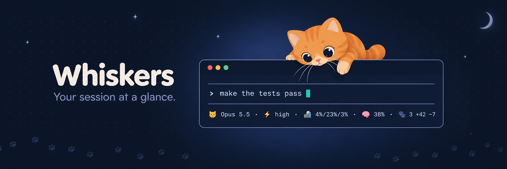

<p align="center">
  
</p>

A tiny status line for Claude Code, shown under the prompt (or above it, see [Position](#position)):

```
🐱 Opus 5.5 · ⚡ high · 📊 24%/33% ↗9%/h · 🧶 ▁▂▃▅▇▅▃▂ 42k/m · 🧠 38%
```

| | What it shows |
| :- | :- |
| 🐱 | The model in use |
| ⚡ | Effort level (shows up after the first reply) |
| 📊 | Usage limits: 5 hour / week / any other window your plan has. In the `above` position, a number turns yellow past 80% and red past 90% |
| ↗ | How fast the 5 hour limit is filling, in % per hour. Only shown while it's moving |
| 🧶 | Tokens spent per minute over the last 8 minutes, and this minute's total. Counts input, cache writes and output (subagents too), not cheap cache reads |
| 🧠 | How full the context window is |
| 🐾 | Files changed and lines +/− for the current prompt, if [Pawprints](https://github.com/elythi0n/pawprints) is installed |

Anything Claude Code has no number for is left out, so the line stays short. Colours follow your Claude Code theme. No network calls, no dependencies: one small file in `hooks/register.tsx`.

## Pawprints

With the `pawprints` binary on your `PATH`, the line also shows what Claude changed during the current prompt:

```
🐱 Opus 5.5 · ⚡ high · 📊 4%/23%/3% · 🧠 38% · 🐾 3 +42 −7
```

Whiskers records nothing itself. It asks Pawprints (`pawprints log --json`) after each round of tool calls, so edits made by Bash, subagents, and background commands count too. Without Pawprints the 🐾 part never appears.

## Install

At the Claude Code prompt:

```
/plugin marketplace add elythi0n/whiskers
/plugin install whiskers@whiskers
```

Pick the user scope so it shows in every session.

## Position

By default the line is added to the end of the dim hint line under the prompt (`? for shortcuts`, `auto mode on`). It's dim like the rest of that line and gets cut off when the line is already long.

For a coloured line with room of its own, open `/config`, find **whiskers › Position**, and pick `above`. It then sits just above the prompt, and usage and context turn yellow past 80% and red past 90%.

## Spending pace

The 🧶 changes when the pace is a problem, judged by your 5 hour limit:

| | Meaning |
| :- | :- |
| 🧶 | Fine: at this pace the limit resets before it fills |
| 🔥 | At this pace the limit fills before it resets. The burn rate shows when, e.g. `↗30%/h full in 2h10m` |
| 🙀 | The limit fills within the hour |

In the `above` position the chart and burn rate also turn yellow and red.

## Settings

Open `/config` and find the whiskers rows:

| Setting | Default | |
| :- | :- | :- |
| Position | `below` | Where the line sits, see [Position](#position) |
| Show model | on | 🐱 |
| Show effort | on | ⚡ |
| Show usage limits | on | 📊 |
| Show burn rate | on | ↗ |
| Show token pace | on | 🧶 `42k/m`, with the 🔥 / 🙀 warnings |
| Show token chart | on | `▁▂▃▅▇` bars next to the pace; off keeps the pace and warnings |
| Show context | on | 🧠 |
| Show edits | on | 🐾, and with it off Pawprints is never asked |
| Send limits to Pawprints | on | Stores each limit reading so `pawprints ui` can chart your limits over time. Only when Pawprints is installed; nothing leaves the machine |

## Update

```
/plugin marketplace update whiskers
/plugin update whiskers@whiskers
```

## Uninstall

```
/plugin uninstall whiskers@whiskers
```

## Developing

Run Claude Code with the plugin loaded from your working copy:

```
claude --plugin-dir ~/path/to/whiskers
```

Saving `hooks/register.tsx` reloads it. Check it with:

```
claude plugin validate .
```
